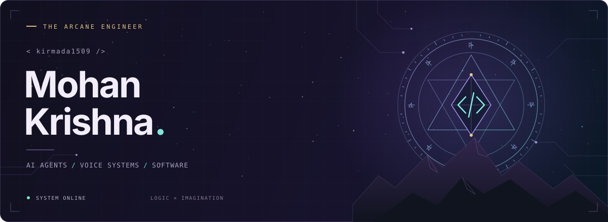

<p align="center">
  
</p>

<p align="center">
  <b>Software & AI Engineer · BITS Pilani · Mathematics & Computing</b><br />
  <sub>Code is the craft. Curiosity is the magic.</sub>
</p>

<p align="center">
  <a href="https://kirmada1509.github.io/"><b>Enter the portfolio ↗</b></a>
  &nbsp; · &nbsp;
  <a href="https://www.linkedin.com/in/mohan-krishna-karthik/">LinkedIn</a>
  &nbsp; · &nbsp;
  <a href="mailto:f20240732@pilani.bits-pilani.ac.in">Send a raven</a>
  &nbsp; · &nbsp;
  <a href="https://kirmada1509.github.io/resume.html">Résumé</a>
</p>

<br />

### ⟡ &nbsp; 01 / The character sheet

I'm **Mohan Krishna**, building AI agents, real-time voice systems, and the infrastructure that makes them useful. I like systems that remember context, explain their decisions, and hold up beyond the demo.

```typescript
const character = {
  handle: "kirmada1509",
  class: "Software & AI Engineer",
  guild: "BITS Pilani",
  craft: [
    "AI agents",
    "Voice infrastructure",
    "Full-stack systems",
  ],
  quest: "Build useful things",
};
```

Engineering Lead at the **Students' Union Technical Team, BITS Pilani**. Open to **software and AI engineering roles and internships**.

<br />

### ⟡ &nbsp; 02 / The spellbook

<table>
<tr>
<td width="50%" valign="top">

#### ◈ [ReEntry](https://github.com/kirmada1509/reentry)
**The memory spell**

A browser task agent for returning to interrupted work: evidence-linked recovery, checkpoint history, and user correction.

<sub>TypeScript · Browser extension · Ollama / NVIDIA</sub><br />
<sub>Technical preview</sub>

</td>
<td width="50%" valign="top">

#### ◇ [Precedent](https://github.com/kirmada1509/precedent)
**The guardian ward**

Checks agent tool calls against past approved and blocked actions, with evidence, human review, and live feedback.

<sub>Python · Moss · Hybrid retrieval</sub><br />
<sub>Prototype · Synthetic held-out evaluation</sub>

</td>
</tr>
<tr>
<td width="50%" valign="top">

#### ♧ [IntervieHire](https://github.com/kirmada1509/interviehire)
**The voice familiar**

An AI interview platform with recruiter-authored rubrics, a self-hosted voice pipeline, and structured evaluation reports.

<sub>LiveKit Agents · Fastify · PostgreSQL · Next.js</sub><br />
<sub>MVP</sub>

</td>
<td width="50%" valign="top">

#### ⌘ [Blackbox](https://github.com/kirmada1509/blackbox)
**The operation ledger**

Cross-session history for BossConsole's MCP operations, with arguments, filtering, and Markdown export.

<sub>Kotlin · MCP · Developer tooling</sub><br />
<sub>Hackathon submission</sub>

</td>
</tr>
</table>

<p align="right"><a href="https://kirmada1509.github.io/#work">More work & engineering notes ↗</a></p>

### ⟡ &nbsp; 03 / The arsenal

| Discipline | Tools of the trade |
| :--- | :--- |
| **Languages** | Python · TypeScript / JavaScript · Go · C++ · SQL |
| **AI & voice** | LiveKit Agents · Deepgram · Cartesia · Ollama · Moss |
| **Applications** | React · Next.js · React Native · NestJS · Fastify · FastAPI |
| **Data & infrastructure** | PostgreSQL · Redis · SQLite · Docker · GitLab CI/CD · Nginx |

<details>
<summary><b>Open the field journal — engineering beyond the prototypes</b></summary>
<br />

- **[OneTap Vendor](https://kirmada1509.github.io/work/onetap.html):** offline-first campus billing serving 5,000+ students, built with Go, Fyne, and SQLite.
- **[BOSM](https://kirmada1509.github.io/work/bosm.html):** a sports festival app for 6,000+ participants, with iOS and Android releases using React Native and Expo.
- **OBS Experiences:** built a modular NestJS backend across 12+ business domains and shipped two production Next.js applications during my software engineering internship.

</details>

<br />

<p align="center">
  
</p>
<p align="center">
  <a href="mailto:f20240732@pilani.bits-pilani.ac.in"><b>Start a conversation ↗</b></a>
</p>
