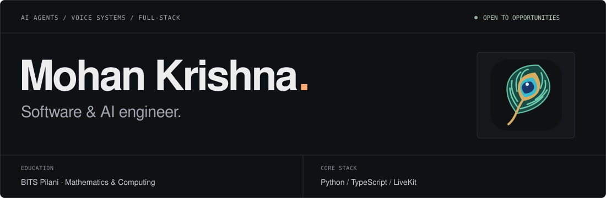
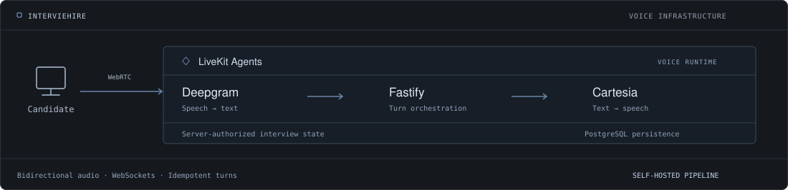

I build **AI agents, real-time voice systems, and the backend infrastructure around them**. My work includes self-hosted interview pipelines, evidence-linked browser agents, and production web and mobile applications.

**BITS Pilani** · B.E. Mathematics & Computing · Graduating 2028 
Open to software and AI engineering roles and internships.

[Portfolio ↗](https://kirmada1509.github.io/) &nbsp; · &nbsp; [LinkedIn ↗](https://www.linkedin.com/in/mohan-krishna-karthik/) &nbsp; · &nbsp; [Résumé ↗](https://kirmada1509.github.io/resume.html) &nbsp; · &nbsp; [Get in touch ↗](mailto:f20240732@pilani.bits-pilani.ac.in)

 

### Things I've built

#### [IntervieHire ↗](https://github.com/kirmada1509/interviehire)

VOICE INFRASTRUCTURE · AI INTERVIEWS · MVP

An AI interview platform with recruiter-authored rubrics, a self-hosted LiveKit voice pipeline, and structured evaluation reports. Built bidirectional session orchestration with server-authoritative timing and idempotent interview turns.

`LiveKit Agents` `Fastify` `WebSockets` `PostgreSQL` 
[Engineering notes ↗](https://kirmada1509.github.io/work/interviehire.html)

<table>
<tr>
<td width="50%" valign="top">

AI AGENTS · TECHNICAL PREVIEW

#### [ReEntry ↗](https://github.com/kirmada1509/reentry)

A browser agent that recovers interrupted work, with evidence-linked progress, checkpoint history, correction, and restore.

`TypeScript` `Ollama / NVIDIA`

[Engineering notes ↗](https://kirmada1509.github.io/work/reentry.html)

</td>
<td width="50%" valign="top">

AGENT RELIABILITY · PROTOTYPE

#### [Precedent ↗](https://github.com/kirmada1509/precedent)

Checks proposed agent actions against past decisions using retrieval and provenance, with human review and live feedback write-back.

`Python` `Moss` `Hybrid retrieval`

[Engineering notes ↗](https://kirmada1509.github.io/work/precedent.html)

</td>
</tr>
<tr>
<td width="50%" valign="top">

LOCAL-FIRST · CAMPUS SOFTWARE

#### [OneTap Vendor ↗](https://kirmada1509.github.io/work/onetap.html)

Offline-first campus billing serving **5,000+ students**, with retry/backoff synchronization, UPI QR payments, and automatic backups.

`Go` `Fyne` `SQLite` `sqlc`

[Engineering notes ↗](https://kirmada1509.github.io/work/onetap.html)

</td>
<td width="50%" valign="top">

MOBILE · PRODUCTION RELEASES

#### [BOSM ↗](https://kirmada1509.github.io/work/bosm.html)

Schedules, leaderboards, verification, and food ordering for **6,000+ participants**. Shipped to iOS and Android through Expo EAS.

`React Native` `Expo` `TypeScript`

[Engineering notes ↗](https://kirmada1509.github.io/work/bosm.html)

</td>
</tr>
</table>

Precedent's evaluation uses synthetic held-out data. Project notes document the scope and limits of the prototypes.

 

### `02` &nbsp; Experience

**Engineering Lead · Students' Union Technical Team, BITS Pilani** 
May 2026 — Present

Lead 20 engineers across frontend, backend, mobile, and UI/UX to deliver campus products, with sprint planning, code reviews, and engineering standards.

**Software Engineering Intern · OBS Experiences** 
May — July 2026

Built a modular NestJS backend spanning 12+ business domains and shipped two production Next.js applications. Automated deployment across four repositories with GitLab CI/CD, Docker, and Nginx.

 

### `03` &nbsp; Tools & technologies

| Area | Stack |
| :--- | :--- |
| **Languages** | Python · TypeScript / JavaScript · Go · C++ · SQL |
| **AI & real-time** | LiveKit Agents · Deepgram · Cartesia · Silero VAD · Ollama · NVIDIA inference · Moss |
| **Applications** | React · Next.js · React Native · NestJS · Fastify · FastAPI |
| **Data & infrastructure** | PostgreSQL · Redis · SQLite · Docker · GitLab CI/CD · Nginx |

 

### `04` &nbsp; Contact

For software and AI engineering opportunities, or to talk about something you're building: 
[f20240732@pilani.bits-pilani.ac.in ↗](mailto:f20240732@pilani.bits-pilani.ac.in)

[kirmada1509.github.io ↗](https://kirmada1509.github.io/) · Pilani, India
